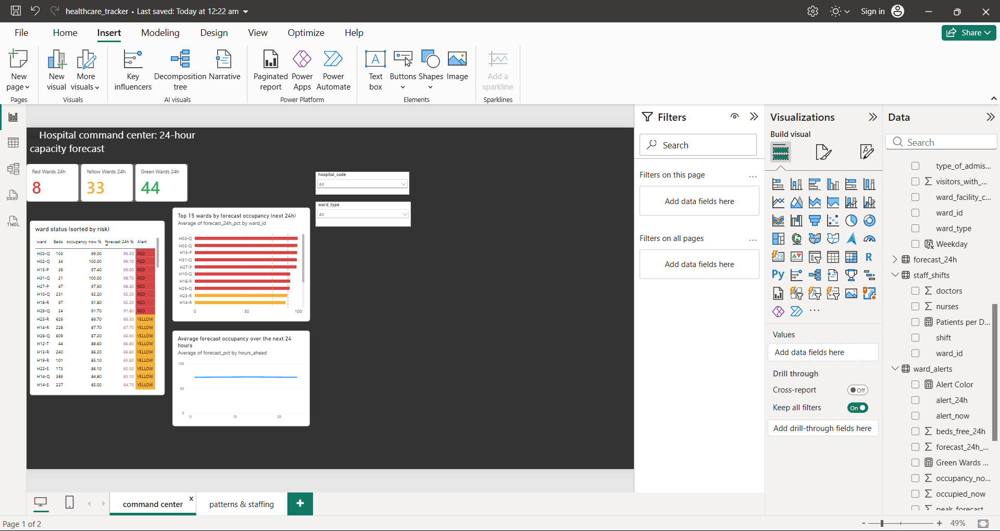
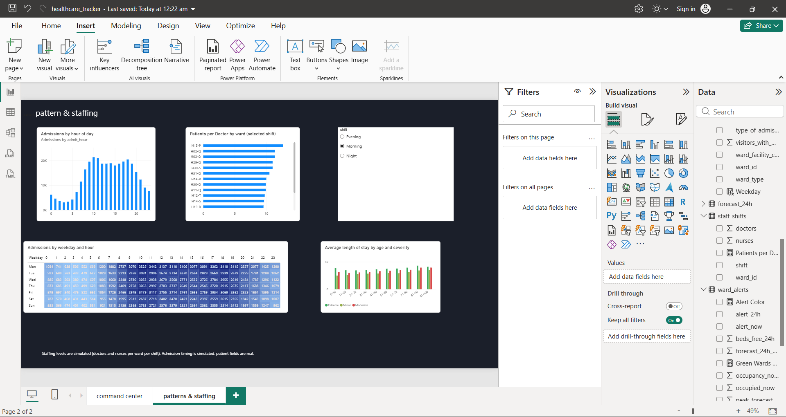
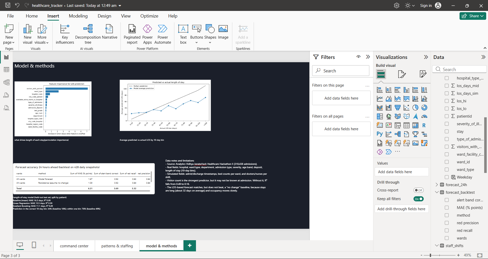

# Healthcare Access & Resource Optimization Tracker

Predicts hospital length of stay, forecasts ward bed capacity 24 hours ahead,
and flags wards at risk of overload with a green/yellow/red alert dashboard.
Built with Python, SQL (SQLite) and Power BI.

## Problem
When wards fill up unexpectedly, hospitals lose efficiency and patient care suffers.
Knowing how long patients will stay, and which wards are close to capacity, helps
managers plan beds and staff ahead of time.

## Data
- **Source:** Analytics Vidhya JanataHack Healthcare Hackathon II (Kaggle),
  318,438 admissions across 32 hospitals (85 hospital/ward-type combinations).
- **Real fields:** hospital, ward type, department, admission type, illness severity,
  age band, admission deposit, visitor count, and length of stay (in 10-day bins).
- **Simulated fields:** the dataset has no timestamps, bed counts, or staffing, so I generated them:
  - admit/discharge times (busier on Mondays, realistic hourly peaks)
  - bed capacity per ward, sized from patient volume
  - doctors and nurses per ward per shift
- Occupancy, staffing and capacity results therefore describe a simulation, not real hospital operations.

## What I did
1. **Data prep (Python):** cleaned the data, converted LOS bins to numbers, generated the
   simulated tables, and loaded everything into SQLite (`prepare_data.py`).
2. **SQL analysis:** 10 queries using CTEs, window functions (RANK, LAG, rolling averages),
   conditional aggregation and joins (`sql/queries.sql`).
3. **ML model:** predicts length of stay from admission-time fields (`los_model.py`).
4. **Capacity forecast:** estimates beds in use per ward over the next 24 hours and assigns
   alerts: green under 75% occupancy, yellow 75-90%, red over 90% (`forecast_capacity.py`).
5. **Dashboard (Power BI):** command center, patterns and staffing, and model/methods pages.

## Key findings
- **Admissions peak at 10-11 am and 5-6 pm** and are lowest at 3 am (about 1% of admissions).
- **Monday is the busiest day** (52,753 admissions vs about 45,000 on a typical weekday
  and 41,100 on Sunday).
- **Severity drives length of stay:** average stay is 36.9 days for extreme cases vs
  28.7 for minor. Stays also rise with age, from 29.4 days (0-10) to 39.1 (81-90).
- **Ward H02-Q is a clear hotspot:** over 90% occupancy on about 38% of days.
- About **9% of ward-days** exceed 90% occupancy. Small wards swing the most, because a few
  patients move their percentage a lot.

## Model results (held-out test set, split by patient)

| Model | MAE (days) | R² |
|---|---|---|
| Baseline (always predict the mean) | 16.2 | 0.00 |
| Linear Regression | 12.5 | 0.39 |
| Gradient Boosting | 11.1 | 0.49 |

The best model predicts the correct 10-day bin 34% of the time (baseline 18%) and is
within one bin 76% of the time (baseline 49%).

**Caveat:** visitor count is the strongest predictor, but it may not be known at admission.
Without it, R² falls from 0.49 to 0.16 (MAE 14.5 days).

## Forecast accuracy (24 hours ahead, 428 daily snapshots)

| Method | Error (% points) | Alert band correct | Red alerts caught |
|---|---|---|---|
| Assume no change from now | 1.59 | 92.2% | 83.6% |
| LOS-model forecast | 1.67 | 91.9% | 83.3% |

The model-based forecast **matches but does not beat** the "no change" baseline. Stays average
about 32 days, so only about 3% of patients leave in any 24 hours and occupancy moves slowly.
I also tested 3, 7 and 14 days ahead and the model did not win at any horizon. The alert system
is still useful (right band 92% of the time), but I would need real discharge patterns,
or a better LOS model, before claiming the model improves capacity planning.

## Dashboard pages
| Command Center | Patterns & Staffing | Model & Methods |
|---|---|---|
|  |  |  |

## How to run
1. Download `train.csv` from the Kaggle dataset and put it in `data/raw/`.
2. `pip install pandas numpy scikit-learn matplotlib scipy`
3. `python prepare_data.py --input data/raw/train.csv --outdir data/processed`
4. `python los_model.py`
5. `python forecast_capacity.py`

## Tools
Python (pandas, scikit-learn, scipy, matplotlib), SQL (SQLite), Power BI (DAX)

## Limitations
- Timestamps, beds and staffing are simulated.
- LOS is given in 10-day bins, so predictions are approximate.
- Predictions for training rows are in-sample, so the forecast backtest is slightly optimistic.
- Some wards exceed 100% occupancy in the simulation, treated as overflow.